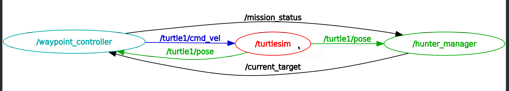

# turtle_patrol — Turtlesim Otonom (ROS 1 Noetic)

Sistem ROS 1 yang menggerakkan `turtle1` di turtlesim secara otonom, tanpa keyboard dan
tanpa teleport. Semua gerak lewat `/turtle1/cmd_vel` dan berdasarkan umpan balik
`/turtle1/pose` (closed loop).

| Level | Isi | Launch |
|---|---|---|
| 1 | Waypoint Patrol (P-controller) | `patrol.launch` |
| 2 | Safe Explorer (sensor virtual dinding) | `explorer.launch` |
| 3 | Hunter (spawn, kejar, kill, skor) | `hunter.launch` |

## Luaran

### Screenshot rqt_graph

**Level 1 — Waypoint Patrol** (`patrol.launch`)


**Level 2 — Safe Explorer** (`explorer.launch`)


**Level 3 — Hunter** (`hunter.launch`)



> Topic `/score` tidak tampil di graph karena belum ada subscriber-nya (rqt_graph
> menyembunyikan topic tanpa pasangan). Lihat isinya dengan `rostopic echo /score`.

### Video demo

<video src="src/turtle_patrol/docs/video.mp4" controls width="720">
  Browser tidak mendukung tag video.
</video>

**[▶ Tonton video demo](src/turtle_patrol/docs/video.mp4)** (`src/turtle_patrol/docs/video.mp4`)

---

## Build

```bash
git clone https://github.com/zahran-rzq/Tugas_SRO_Turtlesim.git
cd Tugas_SRO_Turtlesim      # repo ini adalah catkin workspace
catkin_make
source devel/setup.bash     # atau setup.zsh. Wajib di SETIAP terminal.
```

> **Penting:** jalankan hanya **satu level dalam satu waktu**. Ketiganya mengirim ke
> `/turtle1/cmd_vel`. Hentikan level sebelumnya (Ctrl+C) sebelum memulai level lain.

---

## Menjalankan: cara 1 — file launch (satu perintah)

`roslaunch` otomatis menyalakan `roscore`, turtlesim, semua node, dan parameter.

```bash
roslaunch turtle_patrol patrol.launch      # Level 1
roslaunch turtle_patrol explorer.launch    # Level 2
roslaunch turtle_patrol hunter.launch      # Level 3
```

Level 1 juga bisa dimulai manual lewat service:

```bash
roslaunch turtle_patrol patrol.launch auto_start:=false
rosservice call /start_mission "loop: false"   # loop: true = patroli berulang
```

## Menjalankan: cara 2 — manual dengan `rosrun`

Setiap perintah di **terminal terpisah** (masing-masing setelah `source devel/setup.bash`).
`_nama:=nilai` mengisi parameter private node (`~nama`).

### Level 1: Waypoint Patrol
```bash
# T1
roscore
# T2
rosrun turtlesim turtlesim_node
# T3
rosrun turtle_patrol waypoint_controller.py _kp_lin:=1.5 _kp_ang:=4.0 _tolerance:=0.1
# T4  (muat waypoint SEBELUM menjalankan node; namespace = nama node)
rosparam load $(rospack find turtle_patrol)/config/waypoints.yaml /mission_manager
rosrun turtle_patrol mission_manager.py
# T5  (cara manual tidak punya auto_start, jadi mulai lewat service)
rosservice call /start_mission "loop: false"
```

### Level 2: Safe Explorer
```bash
# T1
roscore
# T2
rosrun turtlesim turtlesim_node
# T3
rosrun turtle_patrol wall_sensor.py _safe_distance:=1.5
# T4
rosrun turtle_patrol explorer.py _speed:=1.5 _turn_front:=1.5 _clear_front:=3.0
```

### Level 3: Hunter
```bash
# T1
roscore
# T2
rosrun turtlesim turtlesim_node
# T3  (controller yang sama dengan Level 1; tolerance 0.5 = jarak tangkap)
rosrun turtle_patrol waypoint_controller.py _kp_lin:=1.5 _kp_ang:=4.0 _tolerance:=0.5
# T4  (_max_targets:=0 berarti tanpa batas)
rosrun turtle_patrol hunter_manager.py _max_targets:=0
# T5  (memantau skor)
rostopic echo /score
```

---

## Level 1 — Waypoint Patrol

turtle1 mengunjungi waypoint secara berurutan, berhenti dengan toleransi jarak < 0.1,
lalu diam setelah waypoint terakhir.

**Mengubah waypoint:** edit satu file, `src/turtle_patrol/config/waypoints.yaml`
(format `[x, y]`, area turtlesim 0..11). Tidak perlu mengubah kode.

| Node | Peran |
|---|---|
| `mission_manager` | Memuat waypoint dari YAML, menyediakan service `/start_mission`, mengirim target aktif, maju ke waypoint berikutnya saat target tercapai. |
| `waypoint_controller` | P-controller: mengejar `/current_target` berdasarkan `/turtle1/pose`, publish `/turtle1/cmd_vel` dan `/mission_status`. |

**Cara kerja controller:**
```
distance  = hypot(gx - x, gy - y)
err       = normalize(atan2(gy - y, gx - x) - theta)   # ke [-pi, pi]
angular.z = Kp_ang * err
linear.x  = Kp_lin * distance      (hanya jika |err| < 0.5 rad)
sampai    = distance < tolerance
```

## Level 2 — Safe Explorer

turtle1 menjelajah arena tanpa menabrak dinding. Custom message `WallSensor` berperan
sebagai sensor virtual.

| Node | Peran |
|---|---|
| `wall_sensor` | Menghitung jarak ke dinding dari `/turtle1/pose` (depan, kiri, kanan lewat ray casting, dan terdekat), publish `/wall_sensor`. |
| `explorer` | Maju sambil berkelok. Jika `front` dekat, berputar ke sisi yang lebih lapang sampai aman (hysteresis). Menjauhi dinding samping saat maju. Publish `/turtle1/cmd_vel`. |

## Level 3 — Hunter

turtle1 mengejar kura-kura target: spawn di posisi acak, kejar, `/kill` saat jarak < 0.5,
lalu ulangi. Skor dipublikasikan di topic `/score`. Seluruhnya otonom.

| Node | Peran |
|---|---|
| `hunter_manager` | Memanggil `/spawn` (target acak), mengirim posisinya ke `/current_target`, memanggil `/kill` saat tertangkap, menaikkan skor, publish `/score`, spawn target berikutnya. |
| `waypoint_controller` | Sama dengan Level 1, dengan `tolerance = 0.5` sebagai jarak tangkap. |

Parameter `hunter_manager`: `max_targets` (0 = tanpa batas), `min_spawn_distance`
(jarak minimum target dari turtle1), `margin` (jarak minimum target dari dinding).

---

## Topic

| Topic | Tipe | Arah | Level |
|---|---|---|---|
| `/turtle1/pose` | `turtlesim/Pose` | turtlesim → controller/sensor/manager | 1, 2, 3 |
| `/turtle1/cmd_vel` | `geometry_msgs/Twist` | controller/explorer → turtlesim | 1, 2, 3 |
| `/current_target` | `turtle_patrol/Waypoint` | mission_manager atau hunter_manager → waypoint_controller (latched) | 1, 3 |
| `/mission_status` | `turtle_patrol/MissionStatus` | waypoint_controller → manager | 1, 3 |
| `/wall_sensor` | `turtle_patrol/WallSensor` | wall_sensor → explorer | 2 |
| `/score` | `turtle_patrol/Score` | hunter_manager → publik | 3 |

## Service

| Service | Tipe | Keterangan |
|---|---|---|
| `/start_mission` | `turtle_patrol/StartMission` | Milik `mission_manager`. Request `bool loop`, response `bool accepted` (false jika misi sedang berjalan). |
| `/spawn` | `turtlesim/Spawn` | Dipanggil `hunter_manager` untuk membuat target. |
| `/kill` | `turtlesim/Kill` | Dipanggil `hunter_manager` untuk menghapus target. |

## Custom message

| Message | Field |
|---|---|
| `Waypoint` | `float32 x, y`, `int32 index, total` |
| `MissionStatus` | `int32 index, total`, `float32 distance`, `bool reached, finished` |
| `WallSensor` | `float32 front, left, right, nearest`, `bool near_wall` |
| `Score` | `int32 caught`, `string target_name`, `float32 distance` |

## Struktur package

```
src/turtle_patrol/
├── msg/      Waypoint, MissionStatus, WallSensor, Score
├── srv/      StartMission
├── scripts/  mission_manager, waypoint_controller, wall_sensor, explorer, hunter_manager
├── launch/   patrol.launch, explorer.launch, hunter.launch
├── config/   waypoints.yaml
└── docs/     rqt_graph_lvl1.png
```

## Kepatuhan aturan
- Gerak hanya lewat `/turtle1/cmd_vel` (tanpa teleop atau teleport).
- Closed loop dari `/turtle1/pose`, bukan sleep atau urutan waktu.
- Lebih dari 2 node buatan sendiri yang berkomunikasi lewat topic.
- Custom message (4) dan custom service (1).
- Satu perintah `roslaunch` per level.
